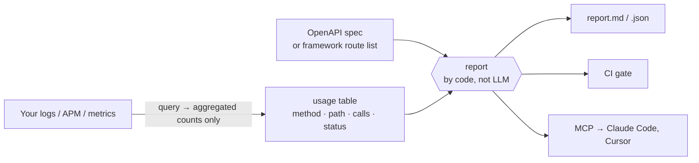

# api-dead-ends

[](https://github.com/talikbaku/api-dead-ends/actions/workflows/test.yml)
[](https://www.npmjs.com/package/api-dead-ends)
[](#ai-agents-mcp-utcp)
[](#ai-agents-mcp-utcp)
[](#ai-agents-mcp-utcp)


**Find API endpoints that fail, are never called, or are missing from your OpenAPI spec — using the logs and metrics you already have.** CLI, MCP server, UTCP manual and Claude Code plugin.

OpenAPI vs real traffic: compares your spec (or your framework's route list) with request counts from your logs, APM or metrics, and finds unused API endpoints, endpoints not called in production, shadow APIs and zombie APIs — an API inventory from facts. Local, never changes your code, zero dependencies, any language.

<picture>
  <source media="(prefers-color-scheme: dark)" srcset="https://raw.githubusercontent.com/talikbaku/api-dead-ends/main/docs/media/report-dark.svg">
  
</picture>

## Don't want to read? Copy this into Claude Code or Cursor

```text
Set up api-dead-ends for me (https://github.com/talikbaku/api-dead-ends) — a local CLI and MCP server (never changes code) that compares my OpenAPI spec (or route list) with real traffic and lists endpoints with errors, endpoints not called in the window, and undocumented (shadow) endpoints.
1. Check Node.js >= 20 (22+ recommended); tell me how to install it if missing.
2. Claude Code: /plugin marketplace add talikbaku/api-dead-ends then /plugin install api-dead-ends@api-dead-ends-marketplace
   Cursor or another MCP client: add server "ade" = {"command":"npx","args":["-y","api-dead-ends@0.3.0","mcp"]}
3. Run detect_project, tell me which services, specs and traffic sources you found, and ask what's missing in one block.
4. Rules: never paste raw logs into the chat, never call non-GET endpoints in production, never call an endpoint "dead" — "not called" is only a hint.
Short docs: https://github.com/talikbaku/api-dead-ends/blob/main/llms.txt
```

## What it finds

| | Finding | Example |
|---|---|---|
| ✖ | **Broken** — share of 5xx per endpoint, plus endpoints with many client errors (4xx) | `POST /promo/apply` — 23% of calls end in 500 |
| ! | **Undocumented (shadow)** — called in production, missing from the spec | `GET /api/v1/products/{id}/reviews` — 34,507 calls |
| ○ | **Not called** in the window — with the window length and a confidence level | `POST /orders/{id}/repeat` — 0 calls in 30 days |
| ↓ | **Deprecated but still called** | `GET /legacy/catalog` — 6,826 calls |
| ▲ | **Recent spikes** — over the 5xx threshold in the last 7/3/1 days and ≥ 3× the days before, hidden by the period average | `POST /payments` — 2.4% 5xx in the last day vs 0.2% before |
| ⧉ | **Duplicates** — the same request several times per page load (`probe`), repeated POST/PATCH from one client (access logs) | `GET /api/me` ×3 on `/` |
| ∅ | **Not logged** — endpoints the ingress/APM sees but app logs miss (`coverage`), "do not log" settings in code (`logging-check`), and marked test requests on staging you can't find in your logs (`logging-probe`) | `location /health { access_log off; }` |

> [!NOTE]
> "Not called" is a hint, not a verdict: the endpoint may be used monthly, by a partner, by an old app version — or its traffic may not be logged. api-dead-ends recommends; a human decides.

## Why not just Datadog, Sentry or an AI?

- **Spec vs reality.** Monitoring shows what is called; it doesn't know what your spec promises. api-dead-ends puts both side by side.
- **Numbers come from code, not from a model.** Same input → same report. AI is optional, on top.
- **CI fails only on what's new** — a new undocumented endpoint or growing use of a deprecated one. Never on "not called".

**Verified on real production data:** Elasticsearch / Kibana / OpenSearch.
**Built from vendor docs, feedback welcome:** Datadog APM & Logs · Prometheus / Thanos / Mimir / VictoriaMetrics · Loki · VictoriaLogs · App Insights · CloudWatch · Athena · BigQuery · New Relic · Dynatrace · Splunk · nginx / Apache / JSON access logs · any CSV



## Quick start

Node.js 20+ (22+ recommended). No install, no dependencies.


```bash
npx api-dead-ends init
```

`init` scans your repo (services, languages, frameworks, specs), asks a few questions — Enter accepts the default — and writes `.api-dead-ends/NEXT-STEPS.md` with the exact commands for each service. It never changes your code.

**Only a browser login to Kibana?** `npx api-dead-ends fetch kibana --url "<Discover URL>" --service my-api --daily -o usage.csv` — a browser opens, you log in, and the export runs through your session (needs Playwright; nothing is saved).

**Something broke today? What changed:** fetch per hour, then compare today with the same hours on previous days:

```bash
npx api-dead-ends fetch victorialogs --url http://localhost:9428 --service gateway --days 3 --hourly --errors errors.json -o usage.csv
#   or: fetch kibana --url "<Discover URL>" --service my-api --days 3 --hourly --errors errors.json -o usage.csv
npx api-dead-ends report --usage usage.csv --spec openapi.json --include-today --errors errors.json --tz America/New_York --out report/
```

The report then says which endpoints got 5xx today and **from which hour** (in your time zone too — compare with your release time), total traffic and peak req/s against the same hours before, endpoints whose **calls and 5xx went up together** (retries, client loops), new and vanished endpoints, and the **error texts** behind the 5xx (from the same traces, IDs masked).

**Need a load test with the same mix?** [logs2k6](https://github.com/talikbaku/logs2k6) (early, v0.1) turns this hourly `usage.csv` into a k6 script with the real endpoint mix and the peak-hour rate.

**Already have an export** from Kibana, Datadog, Prometheus…? Two commands:

```bash
npx api-dead-ends convert elasticsearch kibana-response.json --spec openapi.json -o usage.csv
npx api-dead-ends report --usage usage.csv --spec openapi.json --days 15 --out report/   # the spec can be JSON or YAML
```

**No logs?** Today the tool needs some traffic data — at least nginx/Apache access logs. Options: [no logs](docs/MORE.md#no-logs-at-all).

**Open the HTML report:** `report --out` also writes `report.html` — tabs per finding, and 30/7/3/1-day windows when the usage table has days (`convert … --daily`).

**Front end:** `npx api-dead-ends probe https://your-site --spec openapi.json` opens the site in a browser (needs Playwright) and finds calls sent several times per page, broken and slow calls.

**No OpenAPI spec?** Ask your framework for its route list (`rails routes`, `flask routes`, Spring `/actuator/mappings`, Gin debug output, Laravel `route:list`…):

```bash
npx api-dead-ends spec from-routes routes.txt -o openapi.json
npx api-dead-ends spec from-next ./web -o openapi.json        # Next.js app/ and pages/api
```

## Example report

From the synthetic demo in [`examples/`](examples/) — [full report](examples/report/report.md):

```text
## Summary
- 2 endpoints with server errors (5xx ≥ 1% of calls and ≥ 10 responses) — and 1,624 more 5xx on 3 endpoints below that threshold.
- 2 recent spikes: 5xx over the threshold in the last days and ≥ 3× the days before.
- 1 endpoint with many client errors (4xx other than 401/404 ≥ 10%).
- 3 undocumented endpoints called (not in the spec).
- 3 endpoints not called in 30 days, 2 rare, 2 deprecated but still called. Confidence: low.
```

## By role

| You are | You ask | Look at |
|---|---|---|
| QA / SDET | Which endpoints return 5xx in real traffic? Which have no traffic at all? | Server errors · Client errors · Not called |
| Backend | What does my API actually serve before I refactor or deprecate? | Not called · Deprecated but still called |
| DevOps / SRE | Can I get this from the Prometheus / Loki / ES I already run, with no agent? | `query prometheus --preset …`, `query loki` |
| AppSec | Which undocumented endpoints do real clients hit? Any debug paths answering 200? | Undocumented (flags debug/admin paths) |
| Analyst | Where does the spec differ from reality? | Undocumented · Not called |
| Product | Which features' endpoints does nobody use? | Not called (with confidence) |
| Small team, no logs | What can I get today? | Access logs → `convert accesslog`; see [no logs](docs/MORE.md#no-logs-at-all) |

## AI agents (MCP, UTCP)

<picture>
  <source media="(prefers-color-scheme: dark)" srcset="https://raw.githubusercontent.com/talikbaku/api-dead-ends/main/docs/media/claude-dark.svg">
  
</picture>

<sub>A real Claude Code run with the plugin on the synthetic test project; answer abridged.</sub>

**Claude Code plugin** (MCP server + a skill with guardrails):

```
/plugin marketplace add talikbaku/api-dead-ends
/plugin install api-dead-ends@api-dead-ends-marketplace
```

**Cursor, VS Code, Windsurf, Claude Desktop** — any MCP client:

```json
{ "mcpServers": { "ade": { "command": "npx", "args": ["-y", "api-dead-ends@0.3.0", "mcp"] } } }
```

Seven tools: `detect_project`, `setup_plan`, `build_query`, `spec_from_routes`, `analyze_usage` read inside the working directory; `init` and `write_report` write only `api-dead-ends.config.json` and files under `.api-dead-ends/` (never your code, never an existing file outside it).

**UTCP**: no server needed — `npx api-dead-ends utcp` prints a UTCP manual with the read-only tools (detect, plan, query, spec, analyze) that call the CLI directly. Register it as a `cli` call template in any UTCP client (tested with the UTCP Python client: utcp 1.2.0 + utcp-cli 1.1.5).

Any other chat assistant: paste [`prompts/any-ai.md`](prompts/any-ai.md) with your `report.json`. Details: [docs/MCP.md](docs/MCP.md).

## Safe by default

- **Aggregates only.** The tool reads counts per method + path + status. Raw log lines, IPs, tokens and request bodies never enter it; IDs and token-like path segments are folded to `{id}`, query strings dropped.
- **No network by default.** It prints queries; you run them with your own access. Exceptions you start yourself: `fetch elasticsearch` (your read-only key), `fetch kibana` (your browser login), `fetch victorialogs` (your VictoriaLogs URL; read-only LogsQL) `probe <url>` (a browser on the site you name) and `logging-probe send --url` (marked test requests to the staging URL you name; GET/HEAD only unless you add two explicit flags, rate-limited, no redirects followed).
- **Nothing changes your code.** `init` writes a config and next steps, never overwrites, and keeps raw exports out of git.
- **Traffic is untrusted.** Paths from logs are escaped in reports and in MCP output, so they can't inject Markdown or instructions. [docs/SECURITY.md](docs/SECURITY.md)

## CI gate

```bash
npx api-dead-ends report --usage usage.csv --spec openapi.json --write-baseline baseline.json   # once
npx api-dead-ends report --usage usage.csv --spec openapi.json --baseline baseline.json --fail-on new-shadow,deprecated-growth
```

Exit codes: `0` ok · `1` check failed · `2` bad input.

## Try the demo

```bash
git clone https://github.com/talikbaku/api-dead-ends.git && cd api-dead-ends
node bin/api-dead-ends.mjs report --usage examples/shop-usage-daily.csv --spec examples/shop.openapi.json --out /tmp/report   # then open /tmp/report/report.html
```

All data in `examples/` is synthetic.

## Limits

- **Window.** Logs often keep 7–30 days; monthly jobs may not show up. Confidence: low < 35 days, medium < 90, high ≥ 90. APM metrics keep months — prefer them for "not called".
- **Coverage.** Traffic that bypasses the logged layer, or endpoints that don't log, are invisible.
- **Verified sources.** Elasticsearch/Kibana is verified on real production data; the other adapters are built from vendor docs — please report parsing problems.

## More

**Status:** v0.3.0. [docs/MORE.md](docs/MORE.md) — all flags, thresholds, path templating, framework route lists, no-logs options, FAQ · [docs/SOURCES.md](docs/SOURCES.md) — every source · [docs/MCP.md](docs/MCP.md) · [docs/SECURITY.md](docs/SECURITY.md) · [CHANGELOG.md](CHANGELOG.md) · [CONTRIBUTING.md](CONTRIBUTING.md) · [ACCESSIBILITY.md](ACCESSIBILITY.md)

**Try it on your traffic and tell me what broke** — [open an issue](https://github.com/talikbaku/api-dead-ends/issues). Useful? ⭐ Star the repo.

[MIT](LICENSE) © 2026 Talat Gurbanbayov · also by the author: [logs2k6](https://github.com/talikbaku/logs2k6) — a k6 load test from the same usage table · [curl2k6](https://github.com/talikbaku/curl2k6) — k6 performance regression checks from a curl
